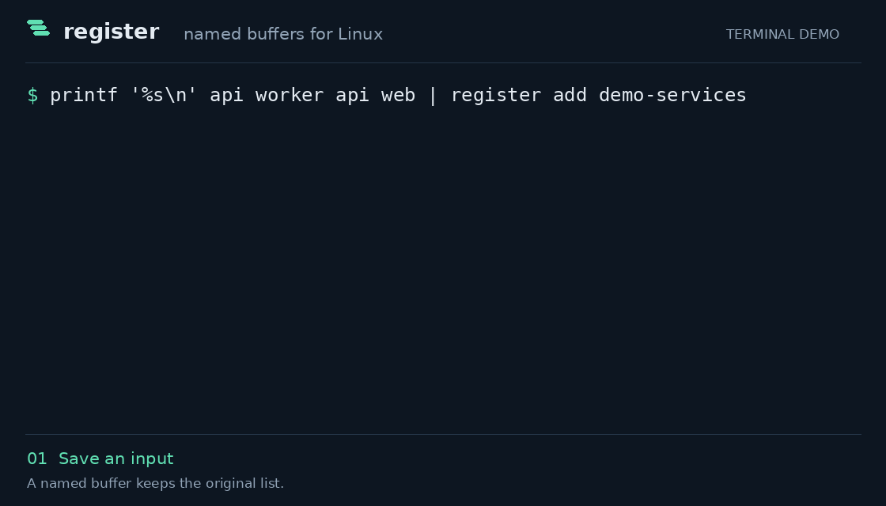

# register

Persistent named buffers for Linux. Save text, file contents, images, or commands; retrieve exact bytes, send them to the clipboard, or execute a saved command.

[Examples](EXAMPLES.md) · [Design decisions](DESIGN.md) · [Tests](#storage-and-tests) · [MIT license](LICENSE)

Buffers survive new terminals and reboots. Keep an input, the command that transforms it, and the result under separate names. JSON arrays, NUL-separated filenames, and PDFs use the same small interface.



## A buffer for each step

Suppose several checks report the same services. Save the list, keep a reusable command to deduplicate it, and capture the result:

```bash
printf '%s\n' api worker api web | register add demo-services
register add demo-unique 'sort -u' --exec
register get demo-services |
    register run demo-unique |
    register add demo-rollout
register get demo-rollout
```

```text
api
web
worker
```

The input, command, and result remain available independently. `get` retrieves bytes; `run` executes a command explicitly. Pipe a new list into `register update demo-services` to replace the input, then rerun the pipeline with `update demo-rollout` to refresh the result. `register show` lists what you have saved.

The animation shows output captured from these commands. After [installation](#install), paste the block once; `add` refuses to overwrite existing names. The longer [examples](EXAMPLES.md) use an isolated store and cover JSON filters, Bash arrays, files, and images.

## Install

Register requires Linux, Python 3.10 or newer, and Bash. It has no Python package dependencies. On Ubuntu or Debian:

```bash
sudo apt-get update
sudo apt-get install -y git
git clone https://github.com/jim-lewis-dev/register.git
cd register
./install.sh --dependencies
```

Open a new Bash terminal, then try the introductory examples. The installer makes `register` available everywhere and enables Tab completion. `--dependencies` uses apt to install missing Python, MIME-detection, and clipboard helpers; the program chooses the desktop clipboard backend automatically. If those dependencies are already installed, `./install.sh` performs only the shell setup.

To try clipboard output after setup, create a text buffer and copy it to the desktop clipboard:

```bash
register add clipboard-note 'Saved with register'
register get clipboard-note CLIPBOARD
```

Paste into a desktop text editor to see the result.

Installation creates a launcher in `~/.local/bin`, a completion loader, and marked PATH and completion blocks in `~/.bashrc`. Both launcher and completion follow the project files. Rerun installation after moving the project. `./uninstall.sh` removes the launcher and completion hooks, keeping the shared PATH setup, project, saved registers, and installed packages.

Shell setup is optional: run `./register --help` or `python3 register --help` from the project folder, and use `./register` wherever the examples say `register`.

## Commands

| Command | Behavior |
| --- | --- |
| `register add NAME [OBJECT]` | Create; error if NAME already exists. |
| `register update NAME [OBJECT]` | Update content or properties; error if NAME is missing. |
| `register copy A B` | Copy bytes and all properties; overwrite B if it exists. |
| `register get NAME` | Write exact bytes to stdout, without adding a newline. |
| `register get NAME CLIPBOARD` | Put the stored content on the clipboard. |
| `register show [NAME ...]` | JSON properties; no names lists all registers in name order. |
| `register remove NAME` | Delete a register. |
| `register run NAME [ARGS ...]` | Execute a register marked executable. |

Use `register --help` or `register COMMAND --help` for command help. Redirect retrieval to save a file: `register get NAME > FILE`.

## Input and properties

`add` and `update` interpret OBJECT in this order:

1. `CLIPBOARD` captures the clipboard.
2. An existing regular file supplies its bytes. This is a snapshot, independent of later changes to that file. Directories, broken symlinks, special files, and unreadable files give errors.
3. Otherwise, OBJECT is literal text. A nonexistent path is stored as text without a warning.

Quotes only preserve spaces. `'README.md'` imports that file if it exists. To store the filename itself, pipe it: `printf '%s' 'README.md' | register add filename`. Piped content is always literal bytes.

An explicit OBJECT takes precedence over stdin. An explicit empty string `''` means empty content. For an object beginning with a hyphen, end option parsing first: `register add option-text -- '-value'`. A single `-` follows the ordinary file-or-text rule.

Without OBJECT, pipes and redirected stdin supply exact bytes. Empty input clears an updated register, including `register update NAME < /dev/null`. With terminal stdin, `add NAME` creates an empty buffer and `update NAME` keeps its contents.

`add`, `update`, and `copy` accept these optional property overrides:

| Property | Flags | Default |
| --- | --- | --- |
| Executable | `--exec`, `--no-exec` | `add` inherits file execute permission; other input starts nonexecutable. `update` preserves the existing value; `copy` inherits A. |
| Text/binary | `--utf8`, `--binary` | Detected from new bytes; otherwise preserved. |
| MIME type | `--mime TYPE` | Detected from new bytes or captured clipboard type; otherwise preserved. |

Only specified properties are overridden. Detection never rewrites content or treats ordinary text as a command. In a terminal, `register update NAME --exec` preserves content. With a pipe, it replaces content and sets the property. To change flags while preserving bytes in any context, use `register copy NAME NAME --exec`.

Names use letters, digits, dots, underscores, and hyphens, with no leading hyphen. `.`, `..`, and `CLIPBOARD` are reserved. Names identify registers independently of source filenames. `show` reports `name`, `exec`, `utf8`, `mime`, and byte `size`.

Completion is installed once and queries current register names on every Tab. `run` offers only executable names. Commands, options, and input files also complete; new register names are yours to type.

## Clipboard and execution

```bash
register add clip CLIPBOARD
register get clip CLIPBOARD
register add picture screenshot.png
register get picture CLIPBOARD
```

Clipboard capture prefers an offered image representation, otherwise text. Image bytes and their MIME type are retained, including PNG and JPEG. Pasting depends on whether the receiving application accepts that type. A file-manager copy may offer a file reference; pass the file path to store actual contents.

Saving never executes content. `run` requires the executable property. A command without a shebang runs in Bash; a shebang chooses its interpreter. Native programs need their normal dependencies. Arguments, stdin, stdout, stderr, current directory, and exit status pass through. A saved `cd` affects only the child process.

See [EXAMPLES.md](EXAMPLES.md) for a JSON-array pick list, Bash filename arrays, reusable replies, binary snapshots, and clipboard workflows. Each example runs in an isolated store.

## Update

For an unmodified GitHub clone, run from the project folder:

```bash
git pull --ff-only
```

Open a new Bash terminal to load any completion changes. Reinstallation is unnecessary.

## Storage and tests

Saved registers live in `~/.register/register.sqlite3`, separately from project source. SQLite changes content and properties together. `REGISTER_HOME` selects another store. Existing metadata-and-file stores are imported automatically; their obsolete copies are removed only after successful import.

Run the complete suite from the project folder:

```bash
python3 -m unittest discover -s tests -v
```

The tests invoke the real CLI in temporary stores and check returned bytes, properties, exit codes, and side effects. They cover file snapshots, pipes and empty input, option placement, command arguments, Bash/native execution, failed writes, concurrent first use, and live completion queries. Separate tests exercise install/uninstall in temporary home folders, export exclusions, and update success or rollback in disposable Git repositories. These checks do not use your saved registers or install packages.

Clipboard tests simulate both desktop backends to verify bytes and MIME handling. They cannot prove that a particular desktop application accepts a paste; use the [desktop checks](EXAMPLES.md#desktop-checks) to verify your own session. CI runs the suite with the Ubuntu 22.04 and 24.04 system Pythons and a current Python, so parser differences across interpreter releases are exercised.

Read [DESIGN.md](DESIGN.md) for the storage model, execution boundary, tradeoffs, and tests behind them. Source review and maintainer ZIP updates are documented separately in [MAINTAINING.md](MAINTAINING.md).

## Contributing

For a bug report, include the command, expected and actual behavior, Python version, and a small input that reproduces it. For a code change, run the suite above and include a regression test for any behavior you fix. Propose new commands before implementing them; a small, predictable interface is the goal.

## License

[MIT](LICENSE), copyright Jim Lewis.
